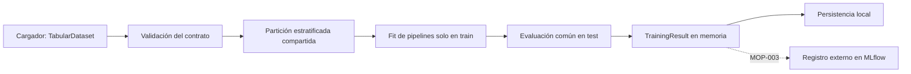

# MOP-002 — Pipeline reproducible de entrenamiento y evaluación

Estado: implementación candidata para revisión técnica. La issue #2 debe
permanecer abierta hasta superar una evaluación de comprensión y obtener la
autorización de cierre. Este documento concreta ADR-001 sin cambiar sus decisiones.

## Flujo y responsabilidades

`data.py` proporciona un contrato y un cargador. `validation.py` verifica
integridad estructural y calcula la huella; no transforma ni aprende estadísticas.
`config.py` valida parámetros. `splitting.py` conserva las posiciones y devuelve
copias de train y test. `models.py` construye pipelines nuevos sin ajustar.
`evaluation.py` calcula las mismas métricas para cualquier candidato binario.
`runner.py` orquesta el entrenamiento en memoria y devuelve `TrainingResult`.
`artifacts.py` conoce archivos, JSON, joblib y procedencia. `cli.py` conecta esas
responsabilidades y presenta el resultado, sin introducir lógica de ML propia.

## Contrato y validación

Otro cargador debe producir `TabularDataset` con un identificador versionable,
un DataFrame de features numéricas reales, una Series de objetivo entero `{0, 1}`,
nombres de columnas esperados, nombre del target y dos nombres de clase.
Los nombres del esquema deben ser strings nativos de Python; el cargador
normaliza los escalares `numpy.str_` de la fuente antes de construir el contrato.
Features y objetivo deben compartir un índice único y ordenado de la misma
manera. El target no puede aparecer con su nombre declarado entre las features.

La validación rechaza esquema incorrecto, índices duplicados o desalineados,
columnas de texto, booleanas o complejas, ausentes, infinitos, objetivos no
binarios y clases demasiado pequeñas. No rellena datos silenciosamente ni
infiere el esquema de una entrada que debería comprobar: los nombres esperados
vienen explícitamente del contrato del cargador.

Rechazar ausentes frente a imputarlos reduce decisiones implícitas en este primer
ejemplo, cuyo dataset no los necesita. Si se introduce imputación, debe añadirse
al pipeline y ajustarse exclusivamente sobre train. Las variables categóricas
exigirán ampliar el contrato y sus transformaciones. Comprobar tipos y esquema
no permite detectar una feature que codifique indirectamente el target; eso
requiere conocimiento del dominio y revisión del origen de los datos.

La división aleatoria supone observaciones independientes. Un dataset con
grupos, pacientes repetidos o dependencia temporal necesitaría otro splitter
y controles para evitar compartir entidades o futuro entre train y test.
El ejemplo no constituye un sistema clínico ni una validación clínica.

## Partición y data leakage

Se divide **antes** de ajustar cualquier transformación. `train_test_split`
recibe posiciones originales, `stratify=target`, semilla y fracción de test.
Ambos modelos reciben la misma partición, con ambas clases representadas.
Las posiciones se guardan para reconstruir la división sobre el dataset con la
misma huella, incluido su orden. La semilla sola no compensa cambios en datos.

Cada candidato es un `Pipeline`: un `ColumnTransformer` selecciona por nombre
las columnas esperadas; para el baseline las escala con `StandardScaler`, y
para LightGBM las deja sin escalar. El selector es útil incluso con una tabla
numérica: conserva selección y orden dentro del modelo persistido y permite
predicción cuando las columnas de entrada llegan reordenadas.

Escalar fuera del pipeline requeriría guardar y aplicar otro objeto y facilita
ajustarlo accidentalmente sobre todos los datos. LogisticRegression se beneficia
del escalado por la optimización y por la penalización comparable de coeficientes.
Los árboles de LightGBM no necesitan ese escalado; ambos mantienen una interfaz
`fit/predict/predict_proba` coherente.

La prueba de leakage compara la media aprendida con train y su número de filas.
Una prueba causal añade un valor grande **solo al test** y verifica que los
coeficientes de LogisticRegression y el modelo interno de LightGBM no cambian.
No basta con comprobar que train y test tienen índices distintos: una media
calculada antes de dividir seguiría filtrando información aunque los índices
finales fueran disjuntos.

## Comparación sin seleccionar con test

Los parámetros son constantes explícitas fijadas antes de evaluar. El baseline
es LogisticRegression con `C=1`, `lbfgs` y hasta 2000 iteraciones. LightGBM usa
100 árboles, learning rate 0.05, 15 hojas y mínimo de 20 muestras por hoja.
Son configuraciones de demostración, sin afirmación de optimalidad.

Se evalúan ambos candidatos una vez sobre el mismo test y se conservan ambos.
No hay ranking con efecto operativo, ganador seleccionado, búsqueda ni early
stopping que observe test. Cambiar parámetros repetidamente tras ver sus métricas
convertiría test en validación y sesgaría su interpretación.

Si una entrega requiere selección, se hará mediante una partición de validación
o validación cruzada **dentro de train**, ajustando el pipeline completo en cada
fold. Una vez congelada la decisión, se evaluará sobre test. No añadimos todavía
esa complejidad porque esta entrega compara candidatos prefijados.

## Métricas y clase positiva

Se conserva la etiqueta original del dataset: `0 = malignant`, `1 = benign`.
La clase positiva matemática es **1**, una convención explícita que no asigna
prioridades ni costes clínicos. Cambiar esa decisión altera precision, recall,
F1 y el significado de la probabilidad positiva.

| Métrica | Definición e interpretación |
| --- | --- |
| Accuracy | `(TP + TN) / N`: proporción de etiquetas acertadas; puede ocultar problemas con clases desbalanceadas. |
| Precision | `TP / (TP + FP)`: proporción de positivos predichos que son positivos reales. |
| Recall | `TP / (TP + FN)`: proporción de positivos reales recuperados. |
| F1 | `2 TP / (2 TP + FP + FN)`: combina precision y recall sin usar TN. |
| ROC-AUC | Ordenación de probabilidades positivas frente a negativos a través de umbrales; no se calcula con las etiquetas discretas. |

El pipeline usa `predict` para etiquetas, con la regla binaria estándar de estos
estimadores, y localiza la columna de probabilidad mediante `classes_.index(1)`.
No presupone que una posición arbitraria de `predict_proba` sea la clase positiva.

Un denominador nulo produce `None` (`null` en JSON). Precision es indefinida si
no hay positivos predichos; recall si no hay positivos reales; F1 si no hay
positivos reales ni predichos; ROC-AUC si los datos evaluados tienen una sola
clase. Accuracy requiere al menos una observación. Esto distingue una métrica
indefinida de una métrica definida con valor cero. El split del flujo completo
exige ambas clases, pero el evaluador conserva ese comportamiento general.

## Reproducibilidad y procedencia

- Python de parche y uv están fijados; `uv.lock` fija dependencias y hashes.
- La semilla controla la partición y la aleatoriedad de LightGBM, que utiliza
  `deterministic=True`, `force_col_wise=True`, CPU y `n_jobs=1`.
  En LogisticRegression, `lbfgs` no utiliza `random_state`; registrarlo no es
  lo que aporta determinismo a ese solver. Importan datos, configuración,
  entorno numérico y control de hilos.
- `threadpoolctl` limita BLAS/OpenMP a un hilo durante fit y evaluación. Reduce
  variación y sobreasignación de CPU en este ejemplo pequeño, a cambio de perder
  paralelismo. La semilla no controla por sí sola esos cálculos nativos.
- La huella combina esquema, tipos, identificador y hashes de filas e índices
  de pandas en su orden, envueltos en SHA-256. El algoritmo depende de pandas,
  cuya versión se registra. Es una identidad operativa, no un certificado de
  calidad ni una garantía matemática contra colisiones de los hashes intermedios.
- El manifiesto guarda versiones instaladas, plataforma, esquema, semilla,
  revisión Git y estado dirty cuando se proporciona la raíz del proyecto, y
  checksums de la configuración del entorno y de cada artefacto.

Las pruebas requieren igualdad de posiciones y métricas/probabilidades con
`rtol=1e-9`, `atol=1e-12` en el mismo entorno. Hardware, compilador y versiones
diferentes pueden variar los cálculos; no se promete reproducibilidad binaria
de modelos serializados. Fecha e ID aleatorio deben diferir entre ejecuciones.
Git puede ser `null` fuera de un checkout identificable de ModelOps. Un checkout
dirty no queda reproducible solo con su revisión: antes de una ejecución que
deba reconstruirse desde Git hay que conservar o integrar esos cambios.

## Persistencia y límites

Cada directorio se reserva con `mkdir(exist_ok=False)` usando UTC y UUID. Los
archivos JSON se crean exclusivamente y los pipelines con modo binario exclusivo.
El manifiesto se escribe al final; solo un JSON válido con estado completo
autoriza consumir una ejecución. Un fallo deja resultados parciales para
diagnóstico y nunca modifica una ejecución anterior.

Joblib conserva el pipeline completo con estadísticas aprendidas y estimador.
Es práctico para objetos scikit-learn/LightGBM, pero puede ejecutar código al
cargar: solo debe usarse con archivos fiables. No se soporta cargar con versiones
de dependencias diferentes. ONNX facilita otros runtimes, pero añade conversión
y comprobaciones de equivalencia; skops ofrece otro modelo de seguridad, con
coste adicional de compatibilidad. No se incorporan a este alcance.

El dataset no se duplica dentro de los artefactos porque viene empaquetado con
la versión registrada de scikit-learn. Un cargador futuro deberá garantizar
acceso a su versión exacta; una huella identifica datos pero no los recupera.
Los hashes detectan cambios si se contrastan, pero no firman ni autentican
artefactos. Este módulo escribe procedencia; no implementa un registro de modelos.

## Integración posterior con MLflow

MOP-003 podrá consumir `TrainingResult` desde una capa de aplicación para registrar
configuración, métricas, huella y pipelines. El entrenamiento y el evaluador no
importan MLflow ni hacen I/O de tracking. La persistencia local sigue siendo una
opción independiente. No se introduce una interfaz genérica de backends antes
de disponer de un segundo caso real; se extraerá si la integración lo justifica.

## Revisión técnica y evaluación pendiente

La validación automática verifica propiedades del código, pero no autoriza
cerrar MOP-002. Después de la revisión técnica se evaluará la comprensión con
preguntas como estas, pidiendo justificación y un ejemplo:

1. ¿Qué información filtra ajustar el scaler antes de dividir y qué prueba lo
   detecta en este repositorio?
2. ¿Por qué la misma semilla no basta si cambia el orden del dataset o el entorno?
3. ¿Cómo introducirías selección de hiperparámetros sin usar test para elegirlos?
4. ¿Qué significa recall aquí y cómo cambia al invertir la clase positiva?
5. ¿Por qué guardar únicamente el estimador perdería parte del comportamiento?
6. ¿Cómo registrarías el experimento con MLflow manteniendo el runner independiente?

El resultado de esa evaluación y la autorización de cierre quedan pendientes;
ningún PR debe cerrar automáticamente la issue #2.

## Referencias

- [Carga del dataset empaquetado](https://scikit-learn.org/stable/modules/generated/sklearn.datasets.load_breast_cancer.html).
- [Leakage y uso de pipelines](https://scikit-learn.org/stable/common_pitfalls.html).
- [Parámetros de determinismo de LightGBM](https://lightgbm.readthedocs.io/en/stable/Parameters.html).
- [Solvers y random_state de LogisticRegression](https://scikit-learn.org/stable/modules/generated/sklearn.linear_model.LogisticRegression.html).
- [Persistencia y limitaciones de compatibilidad](https://scikit-learn.org/stable/model_persistence.html).
