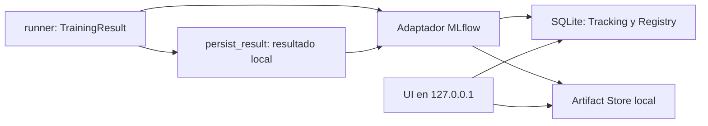

# MOP-003 — MLflow Tracking y Model Registry local

Estado: implementación candidata para revisión técnica y evaluación de
comprensión. No autoriza merge ni cierre de la issue #3.

## Contexto y decisión

MOP-002 devuelve `TrainingResult` en memoria y guarda resultados locales completos.
MOP-003 añade una integración específica con MLflow **3.16.1**, conservando ese
contrato. MLflow aporta consultas y comparación de experimentos, metadatos de
modelos y un Registry versionado; implementar todo eso mediante JSON y carpetas
propias aumentaría el trabajo y la cantidad de contratos que mantener.

La distribución completa permite ejecutar cliente y UI con la misma versión.
`mlflow-skinny` reduce instalación, pero requeriría completar y verificar las
dependencias del backend SQL y del servidor. Elegimos la distribución completa
sin extras cloud. uv resuelve 98 paquetes frente a los 20 de MOP-002, con todas
las versiones y hashes en `uv.lock`. Entre las nuevas ruedas grandes están
PyArrow y MLflow; el coste principal ocurre en la primera instalación. Algunos
componentes web y el SDK de Docker son transitivos; no implican que ModelOps
implemente serving ni que utilice Docker, S3, AWS o PostgreSQL en esta entrega.

SQLite es una excepción de alcance local ya contemplada como alternativa en
ADR-001, no una sustitución del destino PostgreSQL futuro. Ofrece SQL y Registry
sin administrar servicios y funciona con archivos temporales en CI. No es la
elección para escritores concurrentes a gran escala ni para varios hosts. S3
también sigue siendo una decisión futura; ahora se usan archivos en un solo host.
ADR-001 no se modifica.

## Tracking, Registry y Artifact Store

| Concepto | Qué conserva | Identificador |
| --- | --- | --- |
| Tracking | Experimentos, parámetros, métricas, tags, estado y relaciones entre runs | `experiment_id`, `run_id` |
| Registry | Nombres de modelos, versiones y referencias a su fuente y run | Nombre estable + versión, por ejemplo `modelops-baseline/2` |
| Artifact Store | Bytes de pipelines, ejemplos, firmas, requisitos y JSON | URI de archivo guardada en el backend |

SQLite conserva metadatos de Tracking **y** Registry; el directorio de artefactos
conserva los archivos grandes. Tener la base sin esos archivos permite consultar
métricas, pero no recuperar los modelos. Tener los archivos sin la base pierde
la navegación del Registry y parte de su trazabilidad. Hay que respaldar ambos.

Una ejecución local tiene un ID con fecha y sufijo aleatorio; su run padre tiene
otro ID asignado por MLflow. Cada candidato tiene un run hijo diferente. Un
modelo registrado tiene un nombre estable y un contador de versiones propio:
dos candidatos de una misma ejecución no son dos versiones del mismo modelo.

Registrar una versión únicamente establece una referencia trazable y cargable.
No demuestra que sea mejor, no la despliega y no la promociona. No se establecen
alias de producción, stages, rollback ni selección automática.

## Frontera de integración



`runner.py`, `models.py` y `evaluation.py` no importan MLflow. La CLI original
permanece igual. La nueva CLI llama al mismo runner y persiste el mismo resultado;
el adaptador consume ambos. No hay autologging, callbacks de entrenamiento ni
interfaces de plugins. Las firmas se infieren con cinco filas de **train** y
predicciones del pipeline ya ajustado, sin volver a hacer fit ni modificar test.

Se usan `MlflowClient` con backend y Registry explícitos y las APIs
`create_run`, `log_batch`, `log_artifacts`, `create_registered_model` y
`create_model_version`. El pipeline se exporta con `mlflow.sklearn.save_model`.
La relación padre-hijo se expresa mediante `mlflow.parentRunId`.

La alternativa `start_run(nested=True)` con `sklearn.log_model` es válida, pero
introduce estado global de runs y configuración que puede interferir con otro
experimento dentro del mismo proceso. Esta integración no activa ni reanuda
un run ambiental y no cambia los URIs globales. Los modelos quedan como artefactos
del run y versiones del Registry mediante APIs públicas compatibles con 3.16.1;
no se crea además una entidad Logged Model de la nueva API de MLflow 3.

La creación de runs es explícita; la exportación no crea runs ocultos. Parámetros
y métricas se escriben de forma síncrona. Cada hijo queda FINISHED solo después
de registrar su pipeline y versión; el padre termina después de ambos hijos y
sus referencias. Un fallo marca los runs correspondientes FAILED.

## Información registrada

El padre guarda una copia completa de los artefactos locales, manteniendo los
checksums del manifiesto, y `tracking.json` con referencias a hijos y versiones.
Los hijos guardan parámetros compartidos y propios, métricas, JSON de configuración,
pipeline exportado y `registry.json`.

Se registran semilla, fracción de test, candidato, identificador y SHA-256 del
dataset, etiqueta positiva 1, hiperparámetros, Python y versiones relevantes.
El manifiesto conserva además todas las dependencias instaladas, plataforma,
esquema, posiciones de partición y hashes de archivos del proyecto. Revisión
Git y dirty se propagan a tags cuando están disponibles. El adaptador verifica
que el resultado y los artefactos locales corresponden y comprueba sus checksums
antes de crear el experimento o escribir un run.

Los valores `None` no se transforman en cero ni NaN: quedan como `null` en JSON,
sus nombres aparecen en `modelops.undefined_metrics` y no existen como valores
numéricos de Tracking. La consulta combina ambas fuentes para mostrar `null`.
Las métricas definidas con valor cero sí se registran. Los valores no finitos
se rechazan.

El padre no agrega las métricas de dos modelos diferentes. La UI y la CLI comparan
hijos por candidato, semilla y dataset. La CLI incluye solo hijos FINISHED cuyos
padres estén FINISHED, entre hasta 1000 runs recientes. Las ejecuciones parciales
siguen disponibles mediante el cliente o la UI para diagnóstico.

## Configuración local y UI

La configuración compartida resuelve rutas absolutas y genera, por defecto:

- Tracking/Registry: `sqlite:////<raíz>/artifacts/mlflow/mlflow.db` en Linux.
- Artifact location del experimento: `file:///<raíz>/artifacts/mlflow/artifacts`.
- Experimento: `modelops-tabular`.
- Registry: `modelops-baseline`, `modelops-lightgbm`.

Los argumentos prevalecen sobre las variables del mismo parámetro. Las variables
son `MODELOPS_MLFLOW_DIR`, `MLFLOW_TRACKING_URI`,
`MODELOPS_MLFLOW_ARTIFACT_DIR` y `MLFLOW_EXPERIMENT_NAME`. El URI debe representar
SQLite en un archivo; `:memory:`, HTTP, PostgreSQL y cloud no están admitidos aquí.
Las rutas relativas dependen del directorio de invocación: utiliza la raíz del
repositorio o rutas absolutas compartidas entre comandos.

```bash
uv sync --locked
uv run --locked --offline modelops-train-mlflow --seed 42
uv run --locked --offline modelops-train-mlflow --seed 123
uv run --locked --offline modelops-mlflow-runs
uv run --locked --offline modelops-mlflow-ui --port 5000
```

El wrapper de UI utiliza `mlflow server` con backend y Registry iguales, el mismo
artifact root, `--no-serve-artifacts` y host fijo `127.0.0.1`. La aplicación cliente
y el proceso de UI acceden al mismo filesystem. No hay proxy de artefactos ni
dependencia de la UI para entrenar. Esta topología no funciona como almacén
compartido entre máquinas: requeriría otra configuración en una fase posterior.
El wrapper rechaza un artifact root diferente al del experimento existente.

MLflow conserva el artifact location cuando se crea el experimento. Cambiar el
directorio por defecto no mueve los archivos antiguos: se debe mantener la ruta
original o crear otro experimento. No se realiza una migración silenciosa.

## Pipelines, firma y recuperación

Ambos modelos se registran con todo el `Pipeline`, no solo el estimador. Incluyen
selección por nombre y orden de columnas; el baseline incluye el scaler ajustado.
La firma contiene nombres y tipos de entrada y el esquema de salida. El ejemplo
guarda cinco filas válidas de train, excluyendo target.

La firma ayuda a validar el contrato de datos y a detectar columnas ausentes o
tipos incompatibles al utilizar `pyfunc`. No prueba calidad del modelo, ausencia
de leakage, validez del dominio ni seguridad. Cargar el flavor nativo de sklearn
no impone esa firma: mantiene `predict` y `predict_proba` del pipeline.

Cada versión referencia una fuente `file:///.../<child>/artifacts/pipeline` y el
ID del hijo. La salida incluye también `runs:/<child>/pipeline` y
`models:/<nombre>/<versión>`. `load_registered_pipeline` utiliza el backend explícito
para resolver la fuente y carga el flavor nativo sin modificar el URI global:

```python
from modelops.tracking.adapter import load_registered_pipeline
from modelops.tracking.config import resolve_config
from modelops.training.data import load_demo_dataset

config = resolve_config()
pipeline = load_registered_pipeline(config, "modelops-baseline", "1")
features = load_demo_dataset().features.iloc[:5]
labels = pipeline.predict(features)
probabilities = pipeline.predict_proba(features)
```

La futura API podrá resolver y cargar una versión explícita al arrancar y
reutilizar el pipeline en cada petición. Deberá validar entradas y administrar
concurrencia, disponibilidad y cambios de versión; no necesitará entrenar ni
reconstruir el preprocesamiento. Los objetos exportados usan sklearn/LightGBM
y no contienen transformadores propios de ModelOps. No se implementa la API aún.

## Reproducibilidad, seguridad y límites

- Se heredan split, parámetros prefijados, control de hilos y tolerancias de
  MOP-002: `rtol=1e-9`, `atol=1e-12` en el mismo entorno. Tracking no cambia fit,
  evaluación ni selecciona un modelo mirando test.
- Una revisión Git dirty no conserva los cambios locales por sí sola. Hay que
  preservar esos cambios o integrar el código antes de una ejecución formal
  que deba reconstruirse únicamente desde Git.
- Cambiar la semilla cambia la partición. Comparar esas ejecuciones muestra
  variación, no un ganador sobre un holdout común ni una estimación robusta de
  generalización. La selección futura deberá usar validación dentro de train.
- Las versiones exactas relevantes se escriben como requisitos del modelo para
  evitar inferencia automática de dependencias que pueda intentar consultar red.
  Esos requisitos describen el entorno; cargar el flavor nativo no lo recrea.
  El lockfile y la versión de Python siguen siendo la referencia para reproducir.
- Se usa cloudpickle explícitamente para ambos pipelines. MLflow 3.16.1 ofrece
  skops por defecto; validar soporte y tipos de LightGBM con ese formato es una
  mejora futura. Cloudpickle conserva la compatibilidad del ejemplo, pero solo
  deben cargarse artefactos fiables: deserializarlos puede ejecutar código.
- En el entorno validado, MLflow emite una advertencia de SQLAlchemy 2.1 sobre
  la estrategia ORM `noload`, usada por estructuras internas de trazas. La suite
  pasa, pero conviene comprobarla al actualizar cualquiera de esas dependencias.
  La exportación también avisa de que pip no está instalado en el entorno de uv:
  su `conda.yaml` incluye pip sin versión. ModelOps no usa ese archivo para
  reconstruir entornos; utiliza Python fijado, uv y `uv.lock`. No se añade pip
  como dependencia para silenciar ese aviso. El aviso de seguridad de cloudpickle
  permanece visible y corresponde a la política de artefactos fiables.
- La telemetría externa se desactiva por defecto con `MLFLOW_DISABLE_TELEMETRY`;
  tests y UI fuerzan su desactivación. La UI desactiva también ejecución de jobs,
  que no se utiliza. Los tests bloquean conexiones de red en el proceso principal.
- La UI está limitada a loopback y no tiene una configuración de autenticación
  de producción. Otros usuarios del mismo equipo pueden acceder; no se debe
  exponer con proxies o túneles sin diseñar autenticación y autorización.
- Las migraciones SQL de MLflow pueden modificar la base al inicializarse.
  Actualizar exige parar escritores/UI y respaldar base y artefactos. Los tests
  crean una base temporal por caso para aislar esquemas y contadores de versiones.
  La inicialización inicial debe ser secuencial: otro proceso puede observar
  un esquema incompleto durante la migración y ser rechazado. No se fuerza
  una actualización ni se borra la base automáticamente ante ese error.
- Registrar modelos, escribir artefactos y cerrar runs no es una transacción
  atómica conjunta. Una versión ya creada puede permanecer si falla otro paso.
  Se conserva para diagnóstico; no se borra ni promociona automáticamente.
- Repetir tracking crea nuevos runs y versiones, incluso con semilla idéntica.
  No hay deduplicación, política de retención ni reintentos idempotentes.
- Se conserva el resultado local y una copia en MLflow, además de la exportación
  del modelo con su firma: aumenta almacenamiento a cambio de facilitar inspección
  y verificar la frontera entre ambas capas. Las futuras políticas de limpieza
  deberán respetar fuentes referenciadas por versiones del Registry.
- El dataset es exclusivamente técnico; `1 = benign` sigue siendo la clase
  positiva matemática. No se hacen afirmaciones clínicas.

## Validación y revisión pendientes

La suite añade casos de creación y comparación de runs, versiones sucesivas,
JSON con null, recuperación, firmas, equivalencia de predicción, checksums,
fallos y configuración global ajena. Una prueba ejecuta la CLI local con un
import hook que prohíbe MLflow: comprueba independencia de runtime del core,
aunque la instalación completa del proyecto incluya el SDK.

Antes de dar por completada la entrega se revisará el código y se evaluará:

1. ¿Qué conserva SQLite y qué conserva el artifact store? ¿Qué pierde un backup
   que copie solamente uno de ellos?
2. ¿Cómo relacionas execution ID, padre, hijo y versión del Registry?
3. ¿Por qué una versión READY no significa que esté autorizada para producción?
4. ¿Qué valida una firma y qué garantías no aporta?
5. ¿Por qué el adapter usa clientes e IDs explícitos y el runner no conoce MLflow?
6. ¿Cómo interpretarías diferencias entre las semillas 42 y 123 sin seleccionar
   usando repetidamente el conjunto de test?
7. ¿Qué puede quedar escrito si falla el registro del segundo candidato?

Los resultados ejecutados y las limitaciones concretas se incorporarán a la
descripción del PR. La revisión, evaluación y autorización de cierre quedan
pendientes; el PR debe referenciar #3 sin cerrarla automáticamente.

## Referencias consultadas

- [Código de sklearn flavor en MLflow 3.16.1](https://github.com/mlflow/mlflow/blob/v3.16.1/mlflow/sklearn/__init__.py).
- [API de MlflowClient](https://mlflow.org/docs/latest/api_reference/python_api/mlflow.client.html).
- [Backend Store](https://mlflow.org/docs/latest/self-hosting/architecture/backend-store/).
- [Artifact Store](https://mlflow.org/docs/latest/self-hosting/architecture/artifact-store/).
- [Variables de entorno de la versión fijada](https://github.com/mlflow/mlflow/blob/v3.16.1/mlflow/environment_variables.py).
