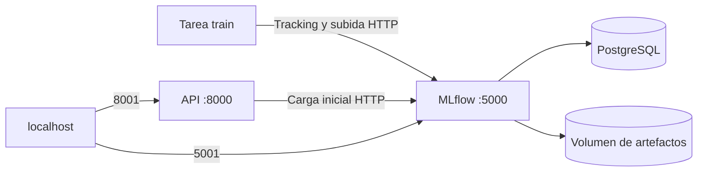

# MOP-005 — API, MLflow y PostgreSQL con Compose

## Demo desde cero

Requisitos: Docker Engine en ejecución, Docker Compose v2 o posterior, acceso
al motor y red para descargar imágenes y dependencias durante el primer build.
Desde la raíz del repositorio:

```bash
cd /home/juanan/Projects/IA/ModelOps
cp -n .env.example .env
docker compose build
docker compose up -d --wait mlflow
docker compose run --rm train
```

El entrenamiento es una tarea puntual separada. Su salida incluye los nombres
y versiones registradas. En una instalación nueva serán `modelops-baseline/1`
y `modelops-lightgbm/1`. Revisa el resultado y fija en `.env` el modelo elegido:

```text
MODELOPS_MODEL_NAME=modelops-baseline
MODELOPS_MODEL_VERSION=1
```

Arranca la API:

```bash
docker compose up -d --wait api
docker compose ps
curl --fail-with-body http://127.0.0.1:8001/health/ready
```

Abre la API en <http://127.0.0.1:8001/docs> y MLflow en
<http://127.0.0.1:5001>. El contrato `/predict` y el JSON de MOP-004 son iguales:
cambia el puerto del `curl` de 8000 a **8001**. Para generar un JSON completo:

```bash
uv run --locked python - <<'PY'
import json
from pathlib import Path
from modelops.training.data import load_demo_dataset
rows = load_demo_dataset().features.iloc[:3].to_dict("records")
Path("/tmp/modelops-predict.json").write_text(json.dumps({"instances": rows}))
PY
curl --fail-with-body http://127.0.0.1:8001/predict \
  -H 'Content-Type: application/json' --data-binary @/tmp/modelops-predict.json
```

Para consultar runs dentro de la red Compose:

```bash
docker compose run --rm train modelops-mlflow-runs
```

Para crear otra ejecución, repite `docker compose run --rm train`; se crean
nuevas versiones, sin cambiar el modelo en memoria de la API. Para servir otra
versión, cambia `.env` y ejecuta:

```bash
docker compose up -d --no-deps --force-recreate --wait api
```

No se importan automáticamente los datos del SQLite anterior. El experimento
de Compose se llama `modelops-compose`; conserva tu Registry local original.

## Entrenamiento de un CSV propio

La imagen de aplicación contiene el ejecutable `modelops` además de
`modelops-train-mlflow`. El comando predeterminado del servicio `train` llama
al segundo para cargar el dataset de demostración. `docker compose run`
permite sustituir ese comando por el flujo CSV y pasarle un volumen de solo
lectura con los datos.

En un clon nuevo, `data/` puede estar vacío: está ignorado por Git para que los
datos no se publiquen. Obtén tu CSV por separado y colócalo, por ejemplo, en
`data/iris/iris.csv`. Construye la imagen y levanta MLflow y PostgreSQL:

```bash
docker compose build api
docker compose up -d --wait mlflow
```

Entrena y registra el modelo con la CLI ejecutada dentro del contenedor:

```bash
docker compose run --rm \
  -v "$PWD/data/iris:/data/iris:ro" \
  train modelops train /data/iris/iris.csv \
  --target species --algorithm lightgbm --name iris_v1
```

El nombre de experimento se fija a `modelops-compose` por la configuración de
Compose. El modelo y sus artefactos se guardan en su Registry y volumen
persistentes. La salida informa la versión registrada. Para hacer una
predicción por lote dentro de otro contenedor:

```bash
docker compose run --rm \
  -v "$PWD/data/iris:/data/iris:ro" \
  train modelops predict /data/iris/nuevas_iris.csv \
  --model iris_v1 --version 1
```

Para servir ese modelo en la API de Compose, inicia o recrea API con el nombre
y versión fijados en el entorno:

```bash
MODELOPS_MODEL_NAME=iris_v1 MODELOPS_MODEL_VERSION=1 \
  docker compose up -d --wait api
curl --fail-with-body http://127.0.0.1:8001/health/ready
```

Si ya habías arrancado API con otra versión, Compose la recrea con esa
configuración. El modelo y el Registry permanecen en Docker; el CSV solo se monta
en el contenedor puntual de entrenamiento/predicción y permanece en el host.

## Topología y artefactos



MLflow y la API utilizan la misma imagen Python 3.12.15 y el mismo lockfile,
con MLflow 3.16.1 y psycopg2-binary. PostgreSQL usa `17.6-bookworm`. Las imágenes
tienen versiones explícitas; actualizar sus etiquetas exige repetir el smoke.
Las etiquetas pueden ser republicadas: no se promete identidad de bytes de
imágenes ni paquetes del sistema operativo entre builds futuros.

Los experimentos remotos usan `mlflow-artifacts:/`. El servidor MLflow hace de
proxy al volumen `/data/artifacts`; los clientes no reciben rutas `file://`
del contenedor. La recuperación descarga a un directorio temporal utilizando
el endpoint explícito, carga el pipeline nativo y elimina la copia temporal.
No modifica el URI global de MLflow. La API no monta volúmenes de modelos ni
necesita la contraseña PostgreSQL.

`TrackingConfig` conserva SQLite+filesystem por defecto. Solo al configurar
`MLFLOW_TRACKING_URI=http(s)://...` usa el servidor; ese modo no crea directorios
locales de tracking y rechaza `--artifact-dir`. La UI remota la sirve Compose;
el wrapper `modelops-mlflow-ui` sigue siendo exclusivamente para SQLite local.

## Imagen, configuración y ciclo de vida

La imagen ejecuta los procesos de aplicación con UID 10001, sin privilegios.
Instala `libgomp1` para LightGBM. Copia primero metadatos y lockfile para
reutilizar la capa de dependencias, después instala el paquete sin modo
editable. Una única etapa mantiene el mismo entorno para los tres procesos;
solo se copia el binario de uv desde su imagen oficial. `.dockerignore` permite
únicamente fuentes, README y archivos de empaquetado: excluye `.git`, `.env`,
credenciales, datos, artefactos y el entorno del host.

`.env.example` contiene valores ficticios para desarrollo. `.env` está ignorado
por Git. Usa una contraseña local distinta si lo necesitas; la interpolación
actual la incorpora al URI SQL y requiere caracteres seguros para URL (letras,
números, guiones y guiones bajos). Cambiarla después de inicializar PostgreSQL
no cambia la contraseña ya almacenada en la base de datos.

Solo API y MLflow publican puertos, ligados a `127.0.0.1`; PostgreSQL queda en
la red interna. Los puertos del host se ajustan con `MODELOPS_API_PORT` y
`MODELOPS_MLFLOW_PORT`. Los clientes dentro de Compose usan `http://mlflow:5000`.
Solo se admiten los hosts locales y el nombre del servicio en MLflow. No hay
autenticación multiusuario ni TLS; se trata de desarrollo local. Solo carga
modelos confiables. El dataset sigue siendo ilustrativo, sin uso clínico.

PostgreSQL debe estar healthy antes de iniciar MLflow. Un único worker MLflow
inicializa el esquema; el entrenamiento y la API esperan su health check.
La API carga una versión al arrancar. Sin modelo válido, liveness devuelve
200 y readiness 503, por lo que Compose la marca unhealthy. Crear después el
modelo exige recrear la API. `--wait` falla si no llega a estar healthy; no
significa que se haya eliminado el contenedor.

Los servicios persistentes tienen `restart: unless-stopped`; un estado unhealthy
por sí solo no reinicia un contenedor. `init: true` y el comando sin shell
propagan señales; API dispone de 20 segundos de apagado. Los logs van a stdout
y stderr. No entrenes varias tareas durante la primera inicialización.

## Persistencia, copia y limpieza

```bash
docker compose down
docker compose up -d --wait
```

Los volúmenes `postgres-data` y `mlflow-artifacts` sobreviven a `down`. Para
comprobarlo, repite `/health/ready` y `/predict`: deben conservar versión y
resultado. Los manifiestos locales de la tarea train están en su `/tmp` y se
eliminan con el contenedor; la copia subida al run padre queda en MLflow.

Para copias coherentes, termina los entrenamientos y detén la API y MLflow;
mantén PostgreSQL activo para exportar y conserva ambos archivos juntos:

```bash
mkdir -p backups
docker compose stop api mlflow
docker compose exec -T postgres pg_dump -U modelops -d mlflow -Fc > backups/mlflow.dump
docker compose run --rm --no-deps -T mlflow tar -C /data/artifacts -czf - . > backups/artifacts.tar.gz
docker compose up -d --wait
```

Para restaurar, usa volúmenes vacíos, la misma versión de PostgreSQL/MLflow y
el mismo nombre de proyecto; importa el dump con `pg_restore` y extrae el tar
en el volumen de artefactos con UID 10001 antes de iniciar MLflow y API. Prueba
la restauración en un proyecto separado antes de reemplazar datos útiles.

`docker compose down --volumes` **elimina los metadatos y modelos de esta pila**.
Úsalo solo para descartar deliberadamente los datos. Las copias contienen
modelos y metadatos: `backups/` está ignorado por Git.

## Comprobación automatizada y diagnóstico

```bash
uv sync --locked
uv run --locked pytest
uv run --locked python scripts/compose_smoke.py
```

El smoke construye la imagen, usa un nombre de proyecto aleatorio y puertos
dinámicos; comprueba liveness sin modelo, readiness 503, entrenamiento real,
subida de artefactos por HTTP, carga y predicción, paridad con el pipeline
recuperado (`rtol=1e-9`, `atol=1e-12`) y persistencia tras `down`/`up`. Al
terminar elimina exclusivamente sus contenedores y volúmenes de prueba. Puede
usarse `--skip-build` después de construir la imagen. No requiere AWS.

```bash
docker compose ps
docker compose logs --tail 100 api
docker compose logs --tail 100 mlflow
docker compose logs --tail 100 postgres
```

- Puerto ocupado: cambia los puertos en `.env` y recrea el servicio.
- API unhealthy: verifica la versión en la salida de train y recrea API.
- Artifact location incompatible: usa el experimento `modelops-compose` en el
  servidor de Compose; no reutilices un experimento con rutas locales.
- Acceso denegado al motor: comprueba permisos de tu instalación Docker.
- Fallo SQL tras cambiar contraseña: restaura la configuración previa o cambia
  la contraseña en PostgreSQL; no elimines volúmenes como solución automática.

Referencias: [proxy de artefactos MLflow](https://mlflow.org/docs/latest/self-hosting/architecture/tracking-server/)
y [orden de arranque Compose](https://docs.docker.com/compose/how-tos/startup-order/).

## Resultado de validación local — 2026-11-04

- Docker Engine 29.7.2 y Compose 5.5.1: construcción real de la imagen correcta.
- Ruff lint y formato correctos; wheel y sdist construidos con uv.
- **164 tests pasan**, incluidos los contratos HTTP y la regresión SQLite.
- Smoke Compose real correcto: PostgreSQL healthy, inicialización de MLflow,
  liveness 200/readiness 503 sin modelo, entrenamiento de ambos candidatos,
  versiones 1 y fuentes `mlflow-artifacts:/`.
- Cinco filas por HTTP coinciden con el pipeline nativo recuperado; tras
  `down`/`up`, identidad y respuesta JSON son idénticas y sigue existiendo una
  sola versión del modelo servido. La API no comparte el volumen de artefactos.
- Proyecto, red y ambos volúmenes temporales eliminados al finalizar.

Quedan los avisos de deprecación de Starlette/httpx y SQLAlchemy/MLflow ya
observados en MOP-004. El entorno uv del contenedor no instala pip: MLflow
avisa al generar `conda.yaml`; la ejecución usa el lockfile y la imagen, no
ese archivo como mecanismo de instalación. No se ha validado restauración
desde backup ni carga sostenida; MOP-006 ampliará las pruebas operativas.
