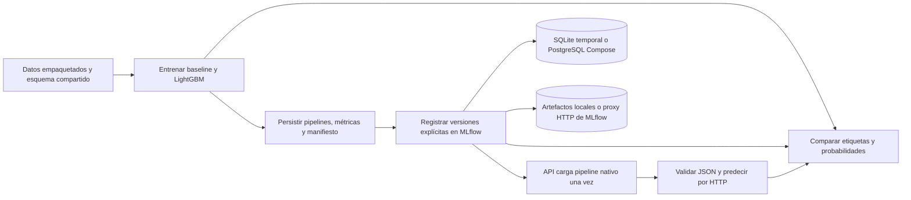

# MOP-006 — Contratos, robustez y cierre técnico de Fase 2

## Circuito probado



No basta un HTTP 200: podría responder un modelo equivocado, aplicar otro
orden de columnas o asociar una probabilidad a la clase incorrecta. Se exige
igualdad exacta de etiquetas y probabilidades equivalentes con `rtol=1e-9`,
`atol=1e-12`. La respuesta identifica nombre, versión y orden de clases.

## Pruebas rápidas

Desde la raíz del repositorio:

```bash
uv sync --locked
uv run --locked ruff check .
uv run --locked ruff format --check .
uv run --locked --offline pytest
uv build
```

La suite usa datos incluidos en scikit-learn, SQLite y artefactos temporales.
No requiere Docker, AWS ni servidores permanentes. TestClient ejecuta el
lifespan usando un context manager. La fixture compartida bloquea conexiones
externas del proceso de tests. El entrenamiento independiente se comprueba
también en un proceso Python aislado, con un endpoint MLflow inaccesible:
entrena ambos candidatos y verifica que no ha importado MLflow.

Para ejecutar únicamente las pruebas de serving:

```bash
uv run --locked --offline pytest tests/test_serving_api.py \
  tests/test_serving_config.py tests/test_serving_integration.py \
  tests/test_serving_robustness.py
```

## Matriz de casos

| Comprobación | Evidencia automatizada | Resultado esperado |
| --- | --- | --- |
| Pipeline original → Registry → HTTP, ambos modelos | `test_serving_integration.py` | Etiquetas iguales y probabilidades dentro de tolerancia |
| Columnas JSON desordenadas, batches 1/N/256 | `test_serving_api.py` | 200 con orden de filas y clases correcto |
| Batches vacíos o mayores que 256, columnas ausentes/extra, formatos erróneos | `test_serving_api.py` | 422 sin invalidar un modelo sano |
| Strings, bool, null, NaN e infinitos | `test_serving_api.py` | 422 sin repetir el valor recibido |
| Resultado de modelo inválido o excepción | `test_serving_api.py` | 500 genérico, readiness 503 hasta reiniciar |
| Configuración sin versión, alias, nombres inválidos | `test_serving_config.py` | Error de configuración, nunca latest |
| Registry vacío o versión inexistente | API e integración SQLite y Compose | Liveness 200; readiness/predict 503 |
| Archivo serializado ausente o corrupto, SQLite corrupto | `test_serving_robustness.py` con almacenamiento real | Sin readiness ni detalles privados en respuestas |
| Nueva versión con predicciones diferentes | `test_serving_robustness.py` | La API sigue sirviendo la versión 1, incluso tras reiniciarla |
| Padre FAILED con versión del Registry READY | Tracking y robustez | Excluido de comparación de runs completos; sin selección automática |
| Ausencia de entrenamiento, consultas y escrituras por petición | API + snapshot de artefactos, runs y versiones | Sin fit, carga única y contenido persistido idéntico |
| Imports entre módulos | Configuración y robustez | Serving no importa training; training no importa MLflow |
| Reinicio y persistencia de PostgreSQL y artefactos | Smoke Compose | Misma identidad y respuesta tras down/up |
| Backend cae con modelo ya cargado | Smoke Compose | Predicción idéntica sin MLflow disponible |
| API nueva mientras el backend está caído | Smoke Compose | Liveness 200, readiness/predict 503 |

READY en el Registry significa que existe un artefacto recuperable. No implica
que la ejecución completa haya terminado, ni que el modelo tenga calidad
suficiente. Se prueba que una versión posterior READY de un padre FAILED no
reemplaza la versión fijada. La selección explícita sigue siendo responsabilidad
del operador: este código no implementa una política de aprobación.

## Prueba real de Compose e informe

Con Docker Engine activo y acceso al socket del motor:

```bash
uv run --locked python scripts/compose_smoke.py \
  --report artifacts/e2e/mop-006.json
```

Construye la imagen, usa un nombre de proyecto aleatorio y publica puertos
dinámicos en localhost. Arranca PostgreSQL antes de MLflow, comprueba el estado
sin modelo, entrena, sube los artefactos por HTTP y verifica la inferencia.
Después detiene MLflow, prueba la API cargada y otra recién iniciada, recrea
la pila conservando los volúmenes y compara de nuevo los resultados.

La API no monta el volumen de artefactos. Recuperar el modelo desde ella y
desde el proceso de prueba demuestra que las referencias `mlflow-artifacts:/`
se resuelven por el endpoint adecuado, incluso al cambiar puertos y redes.
Al finalizar elimina únicamente los recursos del proyecto temporal. En caso
de fallo muestra estado y logs de API antes de limpiar y guarda un informe
con estado fallido. Un cierre forzado del proceso o del host puede impedir el
finally; busca el proyecto `modelops-smoke-*` de ese informe antes de limpiar
manualmente sus recursos.

Para reutilizar una imagen ya construida añade `--skip-build`. Tras cambiar
fuentes, lockfile o Dockerfile, construye de nuevo. Los comandos tienen límites
de tiempo: 600 s para build, 180 s por operación Compose, 60 s para liveness y
15 s por petición de prueba. El timeout de readiness de la pila es 120 s.

El informe guarda:

- Tiempo de arranque de API hasta healthy, incluido Docker y sus health checks.
- Tiempo de recrear la pila persistente hasta healthy.
- Mediana y percentil 95 de 20 peticiones consecutivas sobre 5 filas, incluida
  la transferencia HTTP al host. P95 usa el elemento 19 de las 20 muestras ordenadas.
- Tamaño real de la respuesta en bytes y versiones de Python, MLflow y plataforma.
- Resultado de persistencia y limpieza.

Son mediciones informativas de una máquina y un escenario concretos. No son
SLO, una prueba de carga concurrente ni una garantía de rendimiento. El primer
arranque también depende de cachés de disco e imágenes.

## CI y diagnóstico

CI ejecuta primero lint, formato, tests sobre instalación no editable y build.
Después, el job `compose-e2e` construye y prueba la pila real en un runner
Ubuntu, sin secretos ni AWS. Tiene un límite de 20 minutos y publica el informe
`modelops-e2e` durante 14 días, incluso si falla el smoke. Puede lanzarse con
push, pull request o manualmente desde Actions. Cada job tiene su propio runner;
el entrenamiento y la API usan el mismo lockfile.

Si falla una prueba rápida, repite ese test con `pytest -vv` y conserva su
directorio temporal para inspeccionar artefactos. Si falla Compose, consulta
el informe y el estado/logs que imprime el script. Para la demo persistente
habitual, usa los comandos de [MOP-005](mop-005-compose.md); no elimines sus
volúmenes para resolver un error de configuración.

## Límites de las garantías

Se valida el ejemplo técnico con entradas numéricas y el entorno fijado. No
se valida calidad clínica, sesgo, drift, datos externos, rendimiento bajo
concurrencia, recuperación de backups, alta disponibilidad ni despliegue AWS.
No se selecciona un ganador usando test ni se promociona automáticamente.

Solo se deserializan modelos confiables. Las pruebas de corrupción comprueban
fallos de lectura y de formato; no autentican artefactos ni convierten pickle
en un formato seguro frente a código malicioso. Las tolerancias no prometen
igualdad entre hardware, bibliotecas o versiones diferentes.

La Fase 2 queda preparada para revisión con estas evidencias. El cierre de la
issue y cualquier integración en main requieren revisar la entrega y el
resultado real de CI. MOP-007 (Terraform) es la siguiente fase de infraestructura.

## Resultados locales — 2026-11-04

Se han validado 169 casos: suite completa de 168 tests y el caso adicional de
entrenamiento independiente en un proceso aislado. Ruff, formato y build pasan.
El smoke ampliado con Docker real ha terminado correctamente, incluidas caída
del backend, recuperación persistente y limpieza de los dos volúmenes.

| Medición informativa | Resultado local |
| --- | --- |
| API recreada hasta healthy | 19,44 s |
| Pila persistente recreada hasta healthy | 66,09 s |
| HTTP p50, 20 peticiones de 5 filas | 39,57 ms |
| HTTP p95, 20 peticiones de 5 filas | 54,32 ms |
| Respuesta JSON de 5 filas | 530 bytes |

Entorno: Linux x86_64, Python 3.12.15, MLflow 3.16.1, Docker 29.7.2 y Compose
5.5.1. Informe completo local en `artifacts/e2e/mop-006.json` (ignorado por Git).
Estos tiempos no son comparables directamente con los de un runner de CI.
